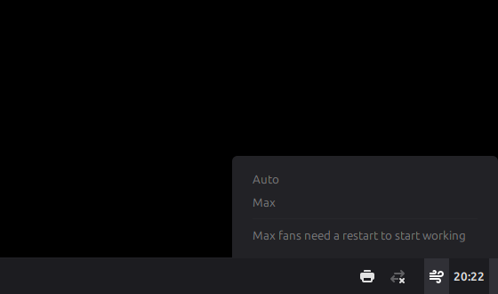
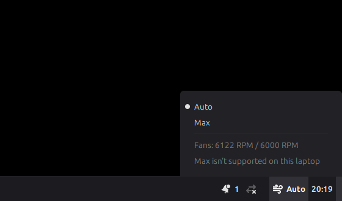

# Max fans on Linux Mint (Acer Nitro)

Adds a fan button to the Linux Mint panel, next to the battery icon. Click it
and choose **Auto** or **Max**. The button shows which mode is on, and the menu
shows the fan speeds. Every restart begins in Auto.

| Auto | Max |
|---|---|
|  |  |

Screenshots from Linux Mint 22.3 Cinnamon. The menu also explains when a
restart is still needed, or when the laptop's firmware refuses Max:

| Before the restart | Max refused |
|---|---|
|  |  |

## Setup

Install Linux Mint Cinnamon. The **Linux Mint 22.3 HWE** download (kernel 7.0)
or Mint 23 is best, because Max fans need kernel 6.19 or later. Install the
NVIDIA driver if Driver Manager offers it. Then open Terminal, paste this line
and enter the password:

```sh
wget -qO /tmp/nitro_fans.py https://raw.githubusercontent.com/ltmerletti/nitro-an515-54-fan-control/main/nitro_fans.py && sudo python3 /tmp/nitro_fans.py install
```

Then restart.

On the standard Mint 22.3 download (kernel 6.14), the command also installs
Ubuntu's 7.0 kernel, which takes a few minutes. It checks that the NVIDIA
driver is ready for the new kernel and tries to fix it if not. If it still
isn't ready, it removes the new kernel again and stops, so the laptop starts
exactly as before. If Mint already follows Ubuntu's newer kernels, the command
leaves the kernel to Mint: install the updates in Update Manager and restart.

If the menu says "Max isn't supported on this laptop", the firmware refused
the request. Both fans stay on Auto, and Mint's power modes still work.

To remove everything: `sudo nitro-fans uninstall`, then restart.
To check the state: `nitro-fans status`.

## How it works

The kernel's `acer_wmi` driver already supports Acer's firmware fan modes
(kernel 6.19 and later), the same ones NitroSense uses on Windows. It only
enables them for models on its list, and the AN515-56 isn't on it. The
installer adds one driver option (`force_caps`). That option keeps the
features the driver already detects (Wi-Fi and Bluetooth switches, brightness)
and adds performance modes, fan readouts and fan modes.

The panel button is a small Cinnamon applet. It reads the fan state from the
driver and switches it through a helper that polkit allows for the logged-in
user without a password. It can only choose firmware Max or firmware Auto. It
never sets a fixed speed and never writes to the embedded controller.

Not yet confirmed on an AN515-56. The same driver option is reported working
on an AN517-55, which isn't on the kernel's list either.
